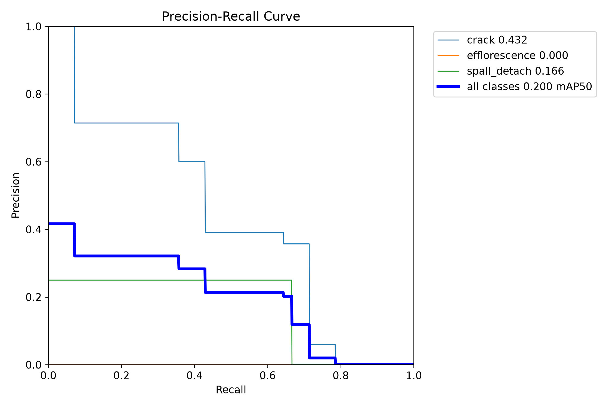
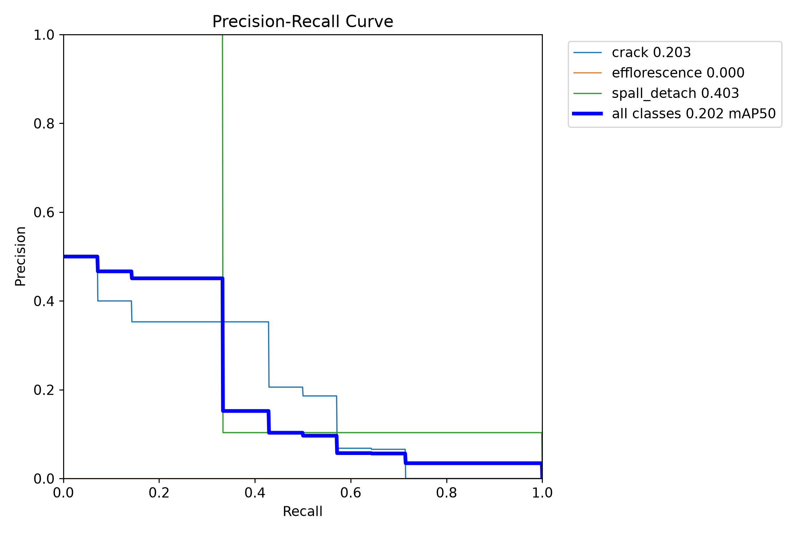
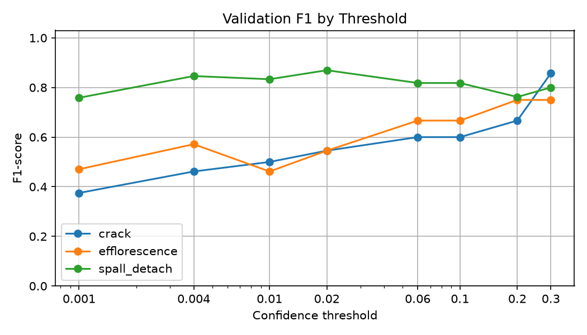
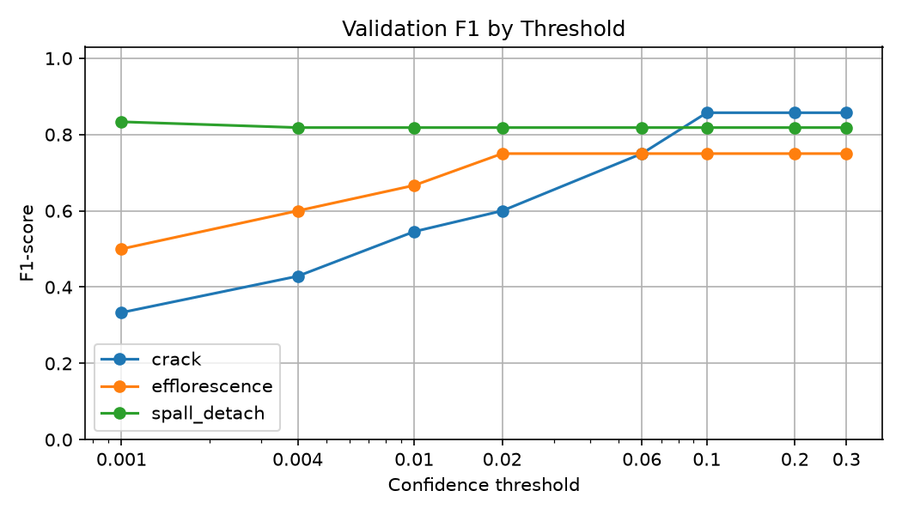
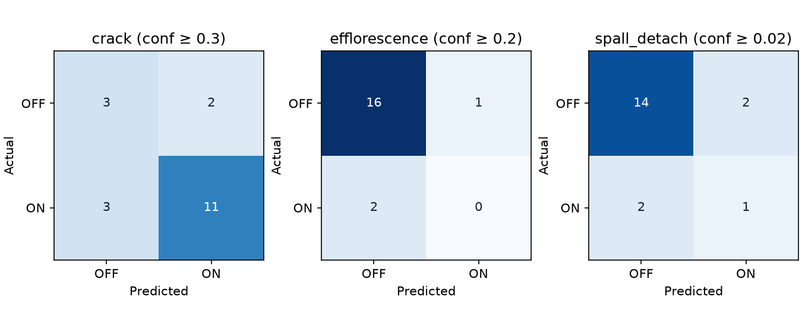
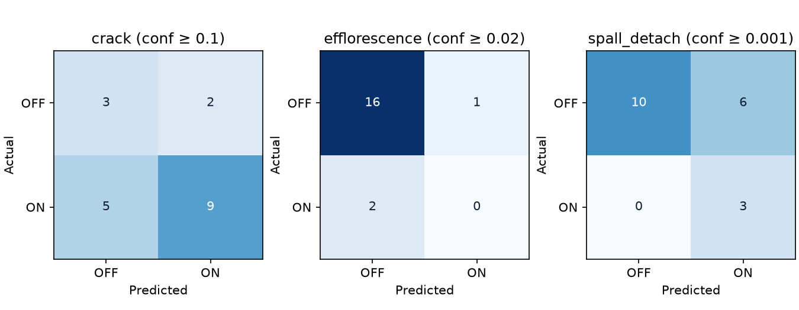

# 지하 콘크리트 결함 탐지 및 모델 비교

지하 콘크리트 표면의 균열(`crack`), 백화(`efflorescence`), 박리·박락(`spall_detach`)을 탐지한다. 세그멘테이션으로 가는 균열과 불규칙한 결함의 경계를 픽셀 단위로 표시한다. 평가는 마스크가 정답과 겹치는 정도와 결함이 포함된 영상을 골라내는 능력을 측정한다.

## 1. 코드 설명

### 데이터 및 전처리

강의 제공 이미지 4,116장 중 0바이트 이미지 63장과 대응 라벨을 분할 대상에서 제외했다. 파일명에서 원본 ID를 추출하고 같은 촬영지 코드를 한 분할에 배정했다. Val·Test에는 원본 ID당 증강 전 이미지 한 장씩을 넣었다. [주석 기준서](docs/annotation_guide.md)와 [1·2주차 기록](docs/week1_week2.md)에 세부 내용을 정리했다.

| 분할 | 이미지 수 | 증강 전 원본 수 | 균열 인스턴스 | 백화 인스턴스 | 박리·박락 인스턴스 |
| --- | ---: | ---: | ---: | ---: | ---: |
| Train | 3,545 | 160 | 779 | 1,819 | 2,490 |
| Val | 19 | 19 | 4 | 7 | 14 |
| Test | 19 | 19 | 14 | 3 | 3 |

### 사용한 모델과 학습·테스트 방법

YOLOv8s-Seg와 YOLOv8n-Seg를 같은 분할과 학습 설정으로 비교했다. 입력 크기 `960`은 가는 균열의 세부 정보를 보존하기 위한 설정이다. Mosaic은 표면의 공간적 맥락 왜곡을 줄이기 위해 끄고, MixUp은 결함 경계의 해석 가능성을 유지하기 위해 껐다. 두 모델 모두 최대 60에폭, `patience=20`, 배치 크기 4, AdamW, 초기 학습률 0.00015, `seed=42`, `deterministic=True`를 사용했다.

YOLOv8s-Seg는 33에폭에서, YOLOv8n-Seg는 46에폭에서 조기 종료됐다. 검증 결과에 따라 저장된 가중치로 3주차 평가를 수행했다. [YOLOv8s-Seg best.pt](models/yolov8s-seg/best.pt) · [YOLOv8n-Seg best.pt](models/yolov8n-seg/best.pt)

3주차 실습 절차에 따라 검증셋에서 모델별·클래스별 임계값을 고르고 테스트셋에 고정 적용했다. 해당 클래스의 예측 신뢰도가 임계값 이상인 인스턴스가 하나라도 있으면 그 영상의 해당 클래스를 ON으로 판정했다. 비교표의 Accuracy, Precision, Recall, F1은 클래스별 영상 단위 ON/OFF 지표의 산술평균이다. Mask mAP는 테스트셋에서 예측 마스크와 정답 마스크의 겹침을 기준으로 계산했다.

### 실행 방법

Windows의 PowerShell에서 실행한다. 실험에는 Python 3.14.7 64비트, PyTorch 2.11.0+cu128, Ultralytics 8.4.200, NVIDIA GeForce RTX 5060 Laptop GPU를 사용했다.

1. 강의에서 제공된 이미지와 라벨을 그대로 `Data/images/{train,val,test}`와 `Data/labels/{train,val,test}`에 배치한다. 코드는 `Data/annotation_selection.txt`를 읽어 원래 촬영지 분할을 재현한다.
2. 저장소 루트에서 가상환경을 설치하고 스크립트를 실행한다.

```powershell
.\setup.bat
.\.venv\Scripts\python.exe main.py
```

스크립트는 `dataset_split_clean/data.yaml`을 생성하거나 기존 분할을 확인한다. 각 모델의 `models/<모델명>/best.pt`를 불러와 평가하며, 해당 가중치가 없으면 공식 사전학습 가중치로 학습하여 생성한다. 한 모델만 실행하려면 `--model yolov8s-seg` 또는 `--model yolov8n-seg`를 사용한다. 원본 데이터는 강의에서 받은 파일을 사용한다.

### 코드 파일별 역할

| 파일 | 설명 |
| --- | --- |
| `main.py` | 모델 선택, 학습 가중치 확인, 두 모델의 평가 및 비교표 저장 |
| `Code/training.py` | 1·2주차 주석 확인, 무결성 점검, 촬영지 단위 분할 및 YOLO 학습 |
| `Code/evaluation.py` | 테스트 Mask mAP, 검증셋 임계값 탐색, 테스트 ON/OFF 평가 및 오류 사례 저장 |
| `Data/annotation_selection.txt` | 기존 분할을 재현하기 위한 주석 대상 이미지 목록 |
| `setup.bat`, `requirements.txt` | 가상환경 생성과 의존성 설치 |

## 2. 모델 성능 비교

| 모델 | Accuracy | Precision | Recall | F1-score | Mask mAP50 | Mask mAP50–95 |
| --- | ---: | ---: | ---: | ---: | ---: | ---: |
| YOLOv8s-Seg | **0.7895** | **0.3932** | 0.3730 | 0.3827 | 0.1995 | 0.0735 |
| YOLOv8n-Seg | 0.7193 | 0.3838 | **0.5476** | **0.4067** | **0.2021** | **0.0868** |

[모델 비교 원본 CSV](results/comparison.csv)

### 성능 분석

YOLOv8n-Seg는 박리·박락 영상 3장을 모두 찾았고, 이 클래스의 F1이 0.5000으로 YOLOv8s-Seg의 0.3333보다 높아 전체 macro F1에서 앞섰다. YOLOv8s-Seg는 균열 영상 14장 중 11장을 찾아 YOLOv8n-Seg의 9장보다 균열을 더 잘 검출했고, 전체 Accuracy와 Precision도 높았다.

### 세그멘테이션 성능

테스트셋 19장으로 측정한 Mask mAP50과 Mask mAP50–95는 위 모델 비교표에 정리했다. 아래 표는 각 클래스의 Mask AP이고, 두 그래프는 IoU 0.50에서 신뢰도 임계값에 따른 마스크 정밀도와 재현율의 관계를 보여준다.

| 클래스 | YOLOv8s-Seg AP50 | YOLOv8s-Seg AP50–95 | YOLOv8n-Seg AP50 | YOLOv8n-Seg AP50–95 |
| --- | ---: | ---: | ---: | ---: |
| 균열 | 0.4323 | 0.1152 | 0.2030 | 0.0606 |
| 백화 | 0.0000 | 0.0000 | 0.0000 | 0.0000 |
| 박리·박락 | 0.1663 | 0.1053 | 0.4033 | 0.1998 |

[YOLOv8s-Seg Mask AP CSV](results/yolov8s-seg/segmentation.csv) · [YOLOv8n-Seg Mask AP CSV](results/yolov8n-seg/segmentation.csv)

| YOLOv8s-Seg 테스트 Mask PR 곡선 | YOLOv8n-Seg 테스트 Mask PR 곡선 |
| --- | --- |
|  |  |

### 검증셋 임계값 탐색

후보 `0.001, 0.004, 0.01, 0.02, 0.06, 0.1, 0.2, 0.3` 중 검증셋 F1이 가장 높은 값을 골랐고, 최고 F1이 같으면 더 낮은 임계값을 선택했다. 예를 들어 YOLOv8n-Seg의 균열 F1은 0.1, 0.2, 0.3에서 0.8571로 같아 0.1을 골랐다. 아래 임계값은 테스트셋에 그대로 적용했다.

| 클래스 | YOLOv8s-Seg 임계값 | 검증 F1 | YOLOv8n-Seg 임계값 | 검증 F1 |
| --- | ---: | ---: | ---: | ---: |
| 균열 | 0.300 | 0.8571 | 0.100 | 0.8571 |
| 백화 | 0.200 | 0.7500 | 0.020 | 0.7500 |
| 박리·박락 | 0.020 | 0.8696 | 0.001 | 0.8333 |

| YOLOv8s-Seg 검증 F1 곡선 | YOLOv8n-Seg 검증 F1 곡선 |
| --- | --- |
|  |  |

[YOLOv8s-Seg 임계값 탐색 CSV](results/yolov8s-seg/val_thresholds.csv) · [YOLOv8n-Seg 임계값 탐색 CSV](results/yolov8n-seg/val_thresholds.csv)

### 테스트셋 ON/OFF 결과

| 모델 | 클래스 | 임계값 | TP | FP | FN | TN | Precision | Recall | F1 |
| --- | --- | ---: | ---: | ---: | ---: | ---: | ---: | ---: | ---: |
| YOLOv8s-Seg | 균열 | 0.300 | 11 | 2 | 3 | 3 | 0.8462 | 0.7857 | 0.8148 |
| YOLOv8s-Seg | 백화 | 0.200 | 0 | 1 | 2 | 16 | 0.0000 | 0.0000 | 0.0000 |
| YOLOv8s-Seg | 박리·박락 | 0.020 | 1 | 2 | 2 | 14 | 0.3333 | 0.3333 | 0.3333 |
| YOLOv8n-Seg | 균열 | 0.100 | 9 | 2 | 5 | 3 | 0.8182 | 0.6429 | 0.7200 |
| YOLOv8n-Seg | 백화 | 0.020 | 0 | 1 | 2 | 16 | 0.0000 | 0.0000 | 0.0000 |
| YOLOv8n-Seg | 박리·박락 | 0.001 | 3 | 6 | 0 | 10 | 0.3333 | 1.0000 | 0.5000 |

[YOLOv8s-Seg ON/OFF CSV](results/yolov8s-seg/test_onoff.csv) · [YOLOv8n-Seg ON/OFF CSV](results/yolov8n-seg/test_onoff.csv)

## 3. Confusion Matrix 분석

각 모델의 `confusion_matrix.png`는 클래스별 2×2 행렬을 보여준다. 행은 실제, 열은 예측이며, 위부터 OFF와 ON 순서다. 모델별 `error_cases/`에는 클래스별 FP와 FN을 최대 3장씩 저장한다. FP는 선택 임계값을 통과한 대상 클래스의 예측 마스크를 표시하고, FN은 해당 클래스의 정답 폴리곤을 표시한다.

### YOLOv8s-Seg



- **가장 잘 분류된 클래스**는 균열로, 클래스별 F1이 0.8148로 가장 높았다.
- **가장 많이 오분류된 클래스**는 균열로, 오탐 2건과 미탐 3건을 합쳐 5건이었다.
- **주요 오분류 유형**은 백화를 균열로 예측하거나 세로 균열을 박리·박락으로 예측한 경우였다.
- **오분류 원인 분석**에서는 띠처럼 이어진 백화와 균열의 형태가 유사하고, 배경과 대비가 낮은 가는 균열의 경계가 흐릿한 점을 확인했다.

| 클래스 | 대표 오탐(FP) | 대표 미탐(FN) |
| --- | --- | --- |
| 균열 | 백화로 주석된 구불구불한 띠를 균열로 예측했다. 띠의 선형 형태가 균열과 유사했다. [사례](results/yolov8s-seg/error_cases/crack/FP_1_USU013_2022_03_16_002_483_jpg.rf.3187438ac65c0b4ae7d4e75f64f2eeed.jpg) | 주변 표면과 대비가 낮은 가는 세로 균열을 놓쳤다. [사례](results/yolov8s-seg/error_cases/crack/FN_2_UCT011_2021_02_12_001_7770_jpg.rf.3b8c7b272fecfca702e16e9af0383b01.jpg) |
| 백화 | 세로 이음선 하단의 밝은 반점을 백화로 예측했다. [사례](results/yolov8s-seg/error_cases/efflorescence/FP_1_URT017_2020_01_14_002_3336.jpg) | 가늘게 이어진 침착물에 백화 판정을 내리지 못했다. 같은 영상에서 균열 오탐이 발생했다. [사례](results/yolov8s-seg/error_cases/efflorescence/FN_1_USU013_2022_03_16_002_483_jpg.rf.3187438ac65c0b4ae7d4e75f64f2eeed.jpg) |
| 박리·박락 | 화면 오른쪽의 세로 균열 주변을 박리·박락으로 예측했다. [사례](results/yolov8s-seg/error_cases/spall_detach/FP_1_URT017_2020_01_12_001_14392.jpg) | 어두운 수평 띠 아래의 작은 탈락부를 놓쳤다. 결함이 띠의 경계와 맞닿아 있다. [사례](results/yolov8s-seg/error_cases/spall_detach/FN_1_URT018_2021_02_10_001_1252.jpg) |

### YOLOv8n-Seg



- **가장 잘 분류된 클래스**는 균열로, 클래스별 F1이 0.7200으로 가장 높았다.
- **가장 많이 오분류된 클래스**는 균열로, 오탐 2건과 미탐 5건을 합쳐 7건이었다.
- **주요 오분류 유형**은 박리·박락 오탐 6건과 균열 미탐 5건이었다.
- **오분류 원인 분석**에서는 화면 가장자리의 균열 주변이 박리·박락으로 예측된 사례를 확인했다. 박리·박락의 임계값이 0.001이어서 낮은 신뢰도의 해당 예측도 ON 판정에 포함됐다.

| 클래스 | 대표 오탐(FP) | 대표 미탐(FN) |
| --- | --- | --- |
| 균열 | 백화로 주석된 띠를 균열로 예측했다. YOLOv8s-Seg에서도 같은 영상에서 오탐이 나왔다. [사례](results/yolov8n-seg/error_cases/crack/FP_1_USU013_2022_03_16_002_483_jpg.rf.3187438ac65c0b4ae7d4e75f64f2eeed.jpg) | 화면 가장자리의 가는 세로 균열을 놓쳤다. 같은 영상의 끝단을 박리·박락으로 예측했다. [균열 미탐](results/yolov8n-seg/error_cases/crack/FN_2_URT017_2020_01_12_001_14392.jpg) |
| 백화 | 벽면의 흰 표시 일부를 백화로 예측했다. 표면 침착물과 밝은 표시가 시각적으로 유사했다. [사례](results/yolov8n-seg/error_cases/efflorescence/FP_1_URT017_2020_02_08_001_24512.jpg) | 표면을 따라 가늘게 퍼진 백화를 놓쳤다. [사례](results/yolov8n-seg/error_cases/efflorescence/FN_2_USU013_2022_03_16_003_5020_jpg.rf.98cb3d969ad8bed3c2ff543b1893f382.jpg) |
| 박리·박락 | 화면 가장자리의 균열 주변을 박리·박락으로 예측했다. 낮은 신뢰도의 예측도 검증셋에서 선택한 0.001 임계값을 통과했다. [사례](results/yolov8n-seg/error_cases/spall_detach/FP_1_URT017_2020_01_12_001_14392.jpg) | 테스트셋에서 미탐 0건이었다. |

## 4. 최종 결과

- **가장 성능이 좋은 모델**은 테스트 macro F1이 0.4067인 YOLOv8n-Seg였다.
- **가장 성능이 낮은 모델**은 같은 기준에서 0.3827을 기록한 YOLOv8s-Seg였다.
- **주요 오분류 클래스**는 오류 건수 기준으로 두 모델 모두 균열이었다. 백화의 경우 두 모델 모두 양성 영상 2장을 놓쳤다.
- **전체적인 실험 결과 및 느낀 점**은 세그멘테이션 성능을 측정해 보니 결함의 위치와 경계를 픽셀 단위로 정확히 탐지하는 일이 생각보다 어렵다는 것이었다. YOLOv8n-Seg는 박리·박락이 있는 영상 3장을 모두 찾았지만, 박리·박락의 Mask AP50–95는 0.1998이었다. 결함이 있는 영상을 찾아내는 성능과 실제 결함 경계를 정확히 그리는 성능을 따로 확인해야 한다는 점을 느꼈다.

